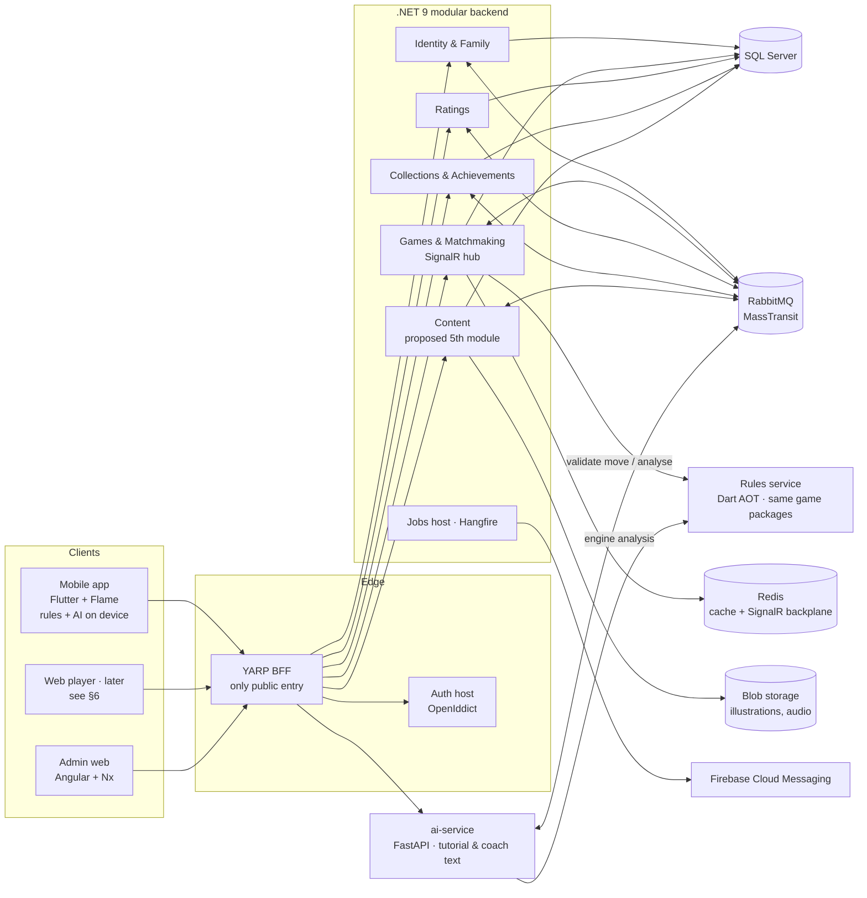
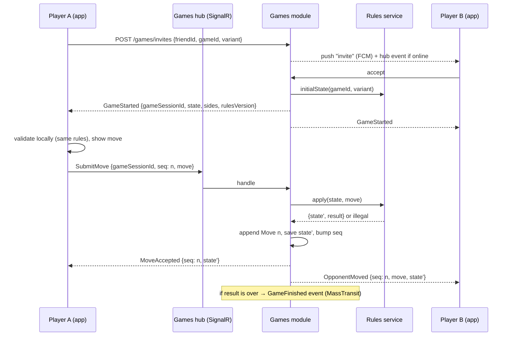

# Liwan architecture proposal

Version 0.1 · 2026-10-10 · Status: **proposal, waiting for product-owner approval (step 6)**. No screens or services are built until it is approved.

> **ملخص بالعربية.** قواعد كل لعبة تُكتب مرة واحدة بلغة Dart، وتعمل في ثلاثة أماكن بالكود نفسه: داخل التطبيق (اللعب دون إنترنت والذكاء الاصطناعي)، وفي خدمة صغيرة على الخادم تتحقق من كل نقلة في اللعب عبر الإنترنت، وفي نسخة الويب. الخلفية .NET مقسّمة إلى وحدات: الهوية والعائلة، والألعاب والمطابقة (SignalR)، والتصنيف، والمجموعات والإنجازات، ونقترح وحدة خامسة للمحتوى. اللعب عبر الإنترنت مع العائلة والأصدقاء المدعوين فقط، والخادم هو الحَكَم. خدمة الذكاء الاصطناعي تكتب نصوص الدروس والمدرب فقط، ولا تختار نقلة أبداً.

---

## 1. Principles

1. **One rules implementation.** Each game's rules exist once, in its pure Dart package (`packages/game_*`). Every place that needs rules (the app, the server, the web) runs that same code. No ports, so no drift.
2. **The server is the referee online.** In online games the server validates every move with the rules package and owns the game record. Clients validate locally too, for instant feedback, but never decide.
3. **Offline first for solo play.** Play vs computer, local pass-and-play, tutorials and heritage stories work with no network. Progress syncs later.
4. **Games are plug-ins.** Adding a game means adding a rules package, a board description, assets and content. The app shell, backend modules and AI do not change.
5. **Safe by design.** No free-text between users anywhere in the system. Children's accounts are managed by guardians. Minimal personal data.
6. **Follow the house skills.** Mobile: `flutter-clean-mobile` (+ Flame); backend: `dotnet-modular-backend`; AI: `python-azure-rag-service`; web: `angular-nx-frontend`. This document only adds what is specific to Liwan.

---

## 2. System overview



---

## 3. Game modules: one rules package, three runtimes

### 3.1 The game module contract

A **game module** is everything one game needs, split by layer:

| Part | Where | Contents |
|---|---|---|
| Rules | `packages/game_<id>` (pure Dart) | `Game<S, M>`, variants, codec, evaluation, AI levels, CLI, tests |
| Board description | `mobile/lib/games/<id>/` | Board geometry (grid or pits), piece/seed mapping to sprites, input mode (tap-to-move, pick-a-pit), notation for move lists, how to animate a move (slide, leap, sow, chain) |
| Assets | `mobile/assets/games/<id>/` | Board and piece skins (SVG from `docs/brand/pieces`), sounds |
| Content | Content module (server) + bundled defaults | Story intro, tutorial lessons, heritage chapters, quick-rules card, preset coach templates |
| Catalog entry | Content module | Id, names (ar/en), order, unlock rule, variants offered to players |

`game_core` gains one small addition to make modules self-describing (built when approved):

```dart
abstract interface class GameModule<S extends Object, M extends Object> {
  String get id;                          // 'shatranj'
  Game<S, M> rules(Map<String, Object?> variant);   // variant options from the catalog
  GameCodec<S, M> get codec;
  Evaluator<S> get evaluator;             // for the AI and the coach
  List<AiLevel> get levels;
  String describeMove(S state, M move, {required String locale});
}
```

The mobile app keeps a `GameRegistry` of modules. Screens (lobby, play, replay, tutorial player) are written once against `GameModule` and the board description; nothing in them is game-specific.

### 3.2 Runtime 1 — on device (mobile)

- The play screen is a Flutter page hosting a Flame `GameWidget`. The BLoC owns the session (players, clocks, AI thinking, online sync). Flame only renders the state and turns taps into moves chosen from `legalMoves`.
- The AI runs in a background isolate (`Isolate.run`) using `game_core` search. The level-4 budget (1 s) keeps the UI at 60 fps.
- The tutorial player loads a lesson script (§5.2), sets positions through the rules package and checks the learner's moves with it.

### 3.3 Runtime 2 — on the server: the Rules service

The backend must validate online moves with **exactly** the same rules. Options:

| Option | How | Pros | Cons |
|---|---|---|---|
| **A. Dart Rules service** (recommended) | A small Dart server (AOT-compiled, `shelf` + JSON, or gRPC) that imports the game packages and exposes `validate`, `apply`, `result`, `analyse`. The Games module calls it over the internal network. | Same code as the app, zero drift; also gives the coach the real engine analysis | One more small deployable in a second language |
| B. Port rules to C# | Re-implement each game in the Games module | Single stack | Two implementations that will drift; doubles test work; violates principle 1 |
| C. Dart → Wasm inside .NET | Compile rules to Wasm, host with Wasmtime in .NET | One process | Immature tooling for Dart Wasm outside browsers; harder debugging |
| D. Client authority + replay checks | Trust clients, verify later | Simple | Not safe for ratings; cheating disputes in families |

**Recommendation: A.** The Rules service is stateless: the Games module sends `{gameId, variant, state, move}` and gets back the new state and result, or an error. It is internal only (not routed by the BFF), scales horizontally, and its container is built from the same commit as the app's packages. Each response carries a `rulesVersion` (package version + hash) so games started on one version finish on it.

### 3.4 Runtime 3 — the web

The same packages compile to JavaScript/Wasm (already checked for shatranj: identical hash keys on VM and JS). See §6 for the web player options.

---

## 4. Online play

### 4.1 Who can play whom

- Only people connected by **family membership** or a **mutual friend invite** (link, QR code, or a short code). There is no public lobby, no search, no random matchmaking in the MVP ("Matchmaking" means invites and rematches).
- A child profile can only be invited by family members, or by a friend the guardian approved.

### 4.2 Game flow



- **Sequence numbers** make moves idempotent: a resent move with an old `seq` is ignored; a move with the wrong `seq` gets the current state back (the client resyncs).
- **Reconnect:** on connect, the client sends its last `seq` per game; the hub replies with missed moves or the full state.
- **Live and correspondence in one model:** if a player leaves, the game simply waits; the opponent gets a "your turn" push. Optional per-game clocks (e.g. 3 days per move for correspondence, or a few minutes for live) are enforced by a Hangfire job that ends overdue games.
- **Preset phrases and emoji** go through the hub as `SendReaction {gameSessionId, reactionId}`: the server checks the id against the admin-managed list and relays it. There is no free-text field in any contract.
- **Draw offers, resign, rematch, undo requests** (undo only if the opponent accepts, family games only) are hub messages validated by the Games module.
- **Scale-out:** SignalR with the Redis backplane; the Games module stores state in SQL, so any instance can serve any game.

### 4.3 Events

| Event (MassTransit) | Published by | Consumed by |
|---|---|---|
| `GameFinished {gameSessionId, gameId, players, result, reason, moves}` | Games | Ratings (update), Collections & Achievements (evaluate rules), ai-service (optional post-game summary) |
| `FamilyMemberJoined`, `FriendshipCreated` | Identity & Family | Achievements ("first family game"), Games (allowed opponents cache) |
| `AchievementUnlocked {userId, achievementId}` | Collections & Achievements | Jobs (push), Identity (profile badges) |
| `ContentPublished {type, id, locale}` | Content | ai-service (re-index heritage stories and rules docs) |

---

## 5. Backend modules (following `dotnet-modular-backend`)

Naming: `Liwan.<Module>.Domain / Application / EntityFrameworkCore / Tests`, one host per module, all behind the YARP BFF (to confirm, see §10).

| Module | Main aggregates | Notes |
|---|---|---|
| **Identity & Family** | `User`, `Profile` (adult/child), `Family`, `FamilyMembership` (guardian, member, child), `Invite`, `Friendship`, `GuardianApproval`, `Block`, `Report` | ASP.NET Identity + OpenIddict (Auth host). Child profiles have no email or password; they sign in on a guardian's device or with a guardian-issued code. |
| **Games & Matchmaking** | `GameInvite`, `GameSession` (gameId, variant, rulesVersion, players, seq, state JSON, result), `Move` (seq, wire move, time), `Reaction` | SignalR `GamesHub`. Calls the Rules service. Replays are the move list. |
| **Ratings** | `Rating` (user, gameId, Glicko-2 r/RD/σ), `RatingChange` | Only rated games between consenting adults or opted-in family games. Hidden for children by default. |
| **Collections & Achievements** | `CatalogItem` (board/piece set/room/card), `Ownership`, `AchievementDefinition` (rule expressed as data), `AchievementProgress` | Rules evaluate `GameFinished` and local-progress sync events. Offline unlocks from the app are re-validated where possible (e.g. a "beat level 5" claim carries the move list, replayed by the Rules service). |
| **Content** *(proposed 5th module)* | `GameCatalogEntry`, `StoryIntro`, `TutorialLesson`, `HeritageChapter`, `QuickRulesCard`, `PresetPhrase`, `CoachTemplate`, with per-locale texts, media and a `draft → in review → published` workflow | Served to the app as versioned content packs; managed in the admin web app. Could live inside Collections, but it has different users (editors), workflow and cache rules, so a separate module is cleaner. |

Jobs host (Hangfire): move-clock expiry, "your turn" reminders, content-pack building, data-deletion requests.

---

## 6. Content and the web

### 6.1 Content packs

- The Content module publishes a **content pack** per locale: catalog, story intros, tutorials, heritage chapters, quick-rules cards, preset phrases, coach templates. Media are in Blob storage behind a CDN.
- The app ships with a bundled pack (so first launch and offline play work) and downloads newer packs in the background (ETag + version). Old packs stay usable.
- Every text has an `ar` and an `en` version; publishing is blocked until both exist and a reviewer approved them. Heritage chapters list their sources (linked to `docs/rules/` and the bibliography).

### 6.2 Tutorial lessons as data

A lesson is a small JSON script checked by the rules package, so a tutorial can never teach a wrong rule:

```json
{
  "id": "shatranj.fil-leap", "game": "shatranj", "order": 5,
  "title": {"ar": "الفيل يقفز مربعين", "en": "The fīl leaps two squares"},
  "steps": [
    {"say": "lesson.fil.intro", "setup": "4k3/8/8/8/8/8/1P6/B3K3 w - - 0 1", "highlight": ["a1", "c3"]},
    {"task": "move", "expect": ["a1c3"], "hintAfterSeconds": 20, "say": "lesson.fil.try"},
    {"say": "lesson.fil.done", "rule": "R5"}
  ]
}
```

Text keys resolve from the content pack. A CI check plays every lesson script against the rules package (each `setup` must parse, each `expect` must be legal).

### 6.3 AI service (following `python-azure-rag-service`)

- **Coach:** `POST /ai-api/coach/explain {game, locale, state, move, engine: {best, scores, pv}}` returns 1–2 sentences. The engine analysis comes from the app (on-device search) or the Rules service; the model only phrases it. Templates are the offline fallback.
- **Storyteller Q&A:** RAG over published heritage chapters and `docs/rules/*.md`, with citations; Arabic analyzer; refuses to answer beyond the sources; child-safe filters on input and output.
- **Tutorial drafting:** an editor tool in the admin app; output always goes to human review.
- Never sees free-text messages between users (there are none), and never chooses moves.

### 6.4 Web player options (later phase, decision needed)

| Option | Pros | Cons |
|---|---|---|
| **A. Flutter web build of the play features** (recommended) | Reuses the Flame boards, BLoCs and assets as they are; one board implementation | Bigger first load; two web stacks (Angular admin, Flutter player) |
| B. Angular player with the rules compiled to JS and a Canvas/SVG board | One web stack, small bundle | A second board renderer to build and keep in sync with mobile |

The admin and any marketing pages stay in Angular + Nx either way.

---

## 7. Mobile app structure (following `flutter-clean-mobile`)

```
mobile/lib/
├── app/            router, DI, theme (tokens from docs/brand/tokens.json), env
├── core/           network, storage, sync queue, notifications, widgets
├── games/          GameRegistry + one folder per game module (board description, sprite mapping)
├── board/          shared Flame layer: BoardGame, BoardComponent, PieceComponent, MoveAnimator, Highlights
└── features/
    ├── auth/  family/  friends/
    ├── lobby/          game list, invites, continue games
    ├── play/           local, vs AI, online (one PlayBloc with three session sources)
    ├── tutorial/       lesson player
    ├── heritage/       chapters, map, storyteller
    ├── collections/  achievements/
    └── settings/       language, sound, motion, accessibility, guardian controls
```

- **Sessions:** `PlaySession` is an interface with three implementations: `LocalSession` (pass-and-play), `AiSession` (isolate search), `OnlineSession` (SignalR client with the seq protocol). The play screen does not know which one it has.
- **Offline progress:** results of local and AI games, tutorial completion and unlocks go into the sync queue and are sent when online.
- Packages: the skill's stack, plus `flame`, `flame_audio`, `signalr_netcore` (or `signalr_core`), and the game packages by path.

---

## 8. Security, privacy and safety

- OpenIddict authorization-code + PKCE for adults; guardian-issued device codes for child profiles; refresh tokens in secure storage.
- **No free text between users** at the API level: no message, nickname search or comment endpoint accepts user text visible to others. Display names of children are chosen from a safe generator or set by the guardian and are visible only inside the family.
- Age gate and guardian consent before a child profile exists; minimal data (display name, avatar, birth year); data export and deletion through the guardian.
- Rate limits on invites and reactions; block and report everywhere a person appears.
- Moves and reactions are validated server-side; game history is append-only.
- Logs never contain tokens or personal data (skill rules).

---

## 9. Delivery plan after approval

| Phase | Builds | Done when |
|---|---|---|
| 1 | `GameModule` in `game_core`; Rules service (Dart) with contract tests; Dart SDK in a SessionStart hook for cloud sessions | Rules service validates a full shatranj game; CI runs every package's tests |
| 2 | Mobile shell (brand kit, routing, ar/en), shared Flame board layer, Shatranj local + vs AI play, tutorial player with 3 lessons | A family can play shatranj vs the AI and locally, offline, in Arabic |
| 3 | Backend: Auth, Identity & Family, Games & Matchmaking (SignalR), BFF; mobile online play | Two family members play online with reconnect and push |
| 4 | Content module + admin app (stories, tutorials, phrases); content packs in the app | Editors publish a heritage chapter in ar/en without a release |
| 5 | Ratings, Collections & Achievements, ai-service coach and storyteller | MVP feature-complete for Shatranj |
| 6 | Manqala and Dama packages (rules research already done), then MVP launch | All three games playable in every mode |

Each phase stays a reviewed branch and pull request.

---

## 10. Decisions needed from you

1. **Server rules:** approve the **Dart Rules service** (§3.3 option A)? *(recommended)*
2. **Content module:** add **Content** as a 5th backend module (§5)? *(recommended)* Or fold it into Collections?
3. **Web player:** Flutter web for the player, Angular for admin (§6.4 option A)? *(recommended, but only needed later)*
4. **Naming:** `Liwan.<Module>.*` namespaces and `liwan` as the Dart/Flutter package prefix?
5. **Child sign-in:** guardian-issued device codes, no email for children (§8)?
6. **Live clocks:** offer optional live clocks in the MVP, or correspondence-style only (no clocks) at launch? *(recommended: correspondence only at launch)*
7. **Still open from earlier steps:** the `flutter-flame-game` skill (`docs/proposals/`) — it would hold the shared Flame board rules in §3.2 and §7; and the GDD questions (monetisation, voice, dialect).
